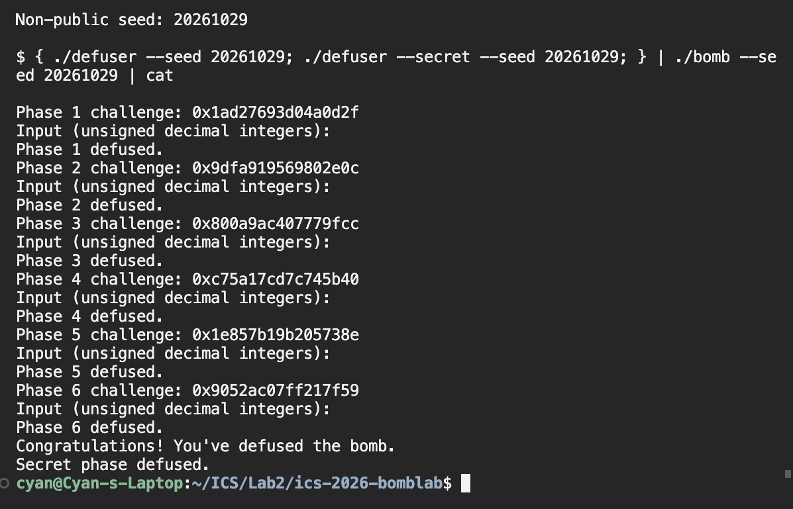
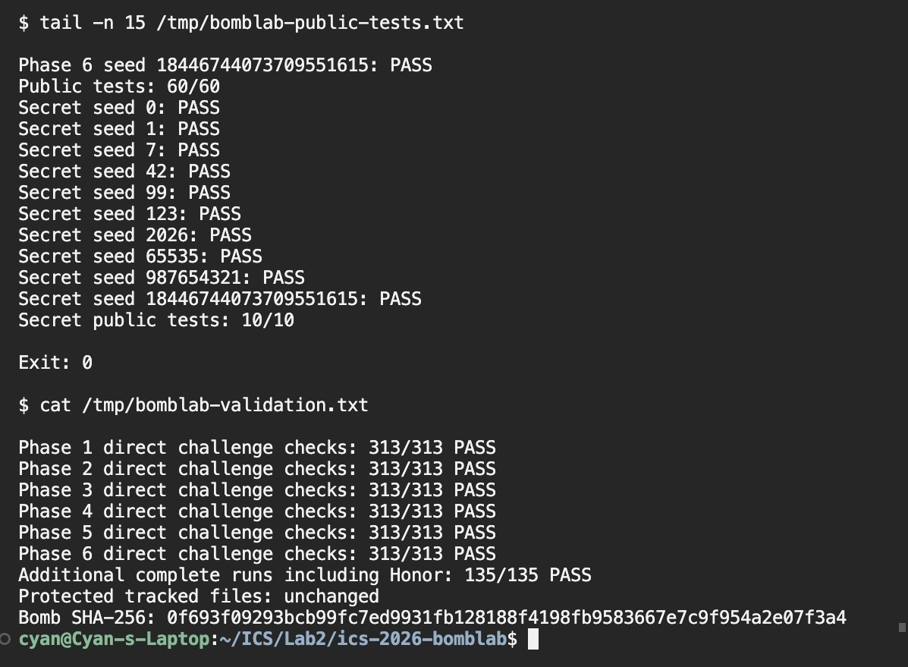

# BombLab 实验报告

## 1. 实验环境与方法

实验在 x86-64 Linux（WSL2）环境中完成。求解程序采用 C11，使用仓库 Makefile 的 `-O2 -Wall -Wextra -Wpedantic -Werror` 选项编译。

分析对象为仓库中的个人 `bomb`，SHA-256 为：

~~~text
0f693f09293bcb99fc7ed9931fb128188f4198fb9583667e7c9f954a2e07f3a4
~~~

先用 `nm --defined-only -n bomb` 定位各关入口、辅助函数和常量表，再用 `objdump -d --no-show-raw-insn -M intel bomb` 追踪计算过程。对跳转表、节点数组和函数指针表，使用 GDB 的 `x` 命令读取实际内容；Honor 的 challenge 与 context 在 `secret_gate` 入口处读取。

求解函数统一写入 `defuser.c`。驱动根据 seed 为每个 phase 生成 challenge，普通关卡输出空格分隔的无符号十进制整数，Honor 输出完整第七行。

以下使用 `c` 表示 64 位 challenge，`lo(x)` 表示取低 32 位，`hi(x)` 表示右移 32 位后取低 32 位。公式中的普通中间量均为 `uint32_t`，加法与乘法按模 2^32 运算，右移采用逻辑右移。`rol32` 和 `ror32` 分别表示 32 位循环左移和循环右移。

## 2. 第一关：调用过程与参数传递

`phase_01` 先检查输入恰好包含一个整数，再调用 `p1_compute` 计算期望值。System V AMD64 调用约定下，前两个整数参数分别通过 RDI、RSI 传入，返回值通过 EAX 返回。这里的计算指令使用 32 位寄存器，结果保留低 32 位。

`p1_step0` 的关键指令是：

~~~asm
402024: lea eax,[rdi+rdi*4]
402027: add eax,esi
402029: xor eax,0xf16f
~~~

这三条指令得到 `(5*a+b)^0xf16f`。另外两个辅助函数分别得到 `4*a+(b^0x6ef3)` 和 `(a+2*b)^0x5062`。

继续追踪 `p1_compute` 中的移位、参数设置和三次调用，可以恢复：

~~~text
L = lo(c)
H = hi(c)
M = lo(c >> 16)
a = (5*L + H) ^ 0xf16f
b = 4*H + (M ^ 0x6ef3)
answer = ((b + 2*L) ^ 0x5062) ^ a
~~~

`402079: mov ecx,eax` 保存第一次调用结果，`40208b: xor eax,ecx` 将其与第三次调用结果合并。输出只包含 answer 一个整数。

非公开 seed `20261029`：challenge 为 `0x1ad27693d04a0d2f`，输出 `2922752528`，炸弹返回 `Phase 1 defused.`。

## 3. 第二关：数组与递推

`phase_02` 要求六个整数。初始项由下面几条指令确定：

~~~asm
402160: shr rax,0x2f
402164: add eax,eax
402166: and eax,0x7e
402169: add eax,0xf
~~~

先右移 47 位，再乘 2 并保留指定低位，因此：

~~~text
v[0] = 2*((c >> 47) & 63) + 15
~~~

循环开始时 EDX 为 1、ECX 为 20。每次循环从 challenge 取一个四位片段，与下标异或，再加上前一项的两倍：

~~~asm
40217d: shr rax,cl
402180: and eax,0xf
402183: xor eax,edx
402185: lea eax,[rax+rsi*2]
402190: add rdx,0x1
402194: add ecx,0x4
~~~

恢复出的递推为：

~~~text
v[i] = 2*v[i-1] + (((c >> (16+4*i)) & 15) ^ i),  i=1,...,5
~~~

读取数组时使用 `[rbp+rdx*4-0x40]`，元素宽度为 4 字节，与六个 `uint32_t` 一致。

非公开 seed `20261029`：challenge 为 `0x9dfa919569802e0c`，六项输出为 `121 251 513 1031 2063 4138`，炸弹返回 `Phase 2 defused.`。

## 4. 第三关：跳转表

`phase_03` 要求两个整数。第一个整数必须等于 `c & 7`；第二个整数由分派函数计算。分派的另一个输入为：

~~~text
index = c & 7
x = lo(c >> 3) ^ hi(c)
~~~

`p3_dispatch` 的核心是：

~~~asm
402264: mov eax,edi
402266: mov edi,esi
402268: cmp eax,0x7
40226d: notrack jmp QWORD PTR [rax*8+0x405820]
~~~

在 GDB 中执行 `x/8gx 0x405820`，得到实际跳转入口：

~~~text
index 0 -> 0x402288 -> p3_case_7
index 1 -> 0x402290 -> p3_case_5
index 2 -> 0x402298 -> p3_case_4
index 3 -> 0x4022a0 -> p3_case_0
index 4 -> 0x4022a8 -> p3_case_6
index 5 -> 0x4022b0 -> p3_case_3
index 6 -> 0x402278 -> p3_case_2
index 7 -> 0x402280 -> p3_case_1
~~~

结合各目标函数的 `lea`、`xor` 和 `shr`，恢复八个分支：

~~~text
index 0: (x ^ 0xf3a7) + (x >> 2)
index 1: 5*x + 0x1aaae
index 2: 3*x + 0xbaf8
index 3: (x ^ 0xa20c) + (x >> 1)
index 4: (4*x) ^ 0x5d92
index 5: 3*x + 0xbe7c
index 6: 5*x + 0x4de45
index 7: (4*x) ^ 0x0580
~~~

输出顺序为 index、分支计算结果。跳转表给出的顺序是实现 switch 的依据。

非公开 seed `20261029`：challenge 为 `0x800a9ac407779fcc`，index 为 4，进入 `p3_case_6`，输出 `4 59898214`，炸弹返回 `Phase 3 defused.`。

## 5. 第四关：递归调用与返回

`phase_04` 要求一个整数。调用 `p4_walk` 前设置的参数为：

~~~text
target = c & 127
salt = lo(c >> 7) ^ hi(c)
low = 0
high = 127
~~~

`p4_walk` 首先计算区间中点：

~~~asm
402348: sub edi,esi
40234a: shr edi,1
40234c: add edi,esi
40234e: cmp edi,eax
~~~

由此得到 `middle=low+((high-low)>>1)`。`jb` 按无符号大小关系选择左半区；另一条路径进入右半区。命中中点时，函数返回 `(middle+0x62)^salt`。

递归返回后，两条路径均执行乘 3、与 `middle+salt` 异或，再分别异或一个方向常量。完整关系为：

~~~text
F(t,L,R,s):
    m = L + ((R-L) >> 1)
    t == m: (m+0x62) ^ s
    t <  m: (3*F(t,L,m-1,s)) ^ (m+s) ^ 0x1a
    t >  m: (3*F(t,m+1,R,s)) ^ (m+s) ^ 0x0b
answer = F(target,0,127,salt)
~~~

关键返回指令分别位于 `40238a—402394` 和 `40236c—402376`。递归的返回顺序决定异或与乘法的位置，因此求解函数保留同样的递归结构。

非公开 seed `20261029`：challenge 为 `0xc75a17cd7c745b40`，target 为 64，中点路径依次为 `63,95,79,71,67,65,64`，输出 `3508057642`，炸弹返回 `Phase 4 defused.`。

## 6. 第五关：结构体布局与链表遍历

`phase_05` 要求两个整数。`p5_traverse` 从入口表取出一个节点，再读取节点的不同偏移：

~~~asm
402444: mov rdx,QWORD PTR [rax*8+0x405b60]
402457: mov esi,DWORD PTR [rdx+0x8]
40245c: xor eax,DWORD PTR [rdx+0xc]
402475: mov rdx,QWORD PTR [rdx]
~~~

偏移 0 是 8 字节 next 指针，偏移 8 是 4 字节 value，偏移 12 是 4 字节 salt，节点大小为 16 字节。节点数组从 `0x405ba0` 开始，使用 `(节点地址-0x405ba0)/16` 将指针转换为数组下标。

执行 `x/8gx 0x405b60` 与 `x/48wx 0x405ba0`，得到入口与节点数据：

~~~text
heads = [6,4,1,9,7,0,10,3]

index  next  value   salt
0      10    0x070f  0x4311
1       9    0x094d  0xbb2e
2       5    0x042f  0x492f
3       8    0x0645  0xf9c0
4       1    0x0369  0x33ee
5      11    0x0067  0x00ea
6       4    0x0b78  0x8485
7       0    0x011a  0x0384
8       2    0x023a  0x366d
9       7    0x0876  0xe2c0
10      3    0x0a12  0x425a
11   NULL    0x0555  0xf4d1
~~~

入口下标为 `c & 7`，沿 next 前进的次数为 `(c >> 3) & 3`。入口节点也参与计算，所以实际处理的节点数量为前进次数加一。

累加器及每个节点上的更新关系为：

~~~text
acc = lo(c >> 6) ^ hi(c) ^ 0xc3cb
acc = (acc ^ node.salt) + node.value
~~~

第二个输出整数是最后一个已处理节点的 value。实现中用下标保存 next 关系，保持原链表的访问顺序。

非公开 seed `20261029`：challenge 为 `0x1e857b19b205738e`，入口为 heads[6]，前进一次，访问节点 `10 -> 3`。输出 `2018313949 1605`，其中最后节点的 value 为十进制 1605，炸弹返回 `Phase 5 defused.`。

## 7. 第六关：函数指针表与间接调用

`phase_06` 要求一个整数。`p6_dispatch` 中的两次间接调用为：

~~~asm
4025b6: call QWORD PTR [rax*8+0x405e00]
4025bd: xor eax,0x9223
4025c4: call QWORD PTR [rbx+0x405e00]
4025cf: add eax,0xc1d7
~~~

第一次调用的索引是 `c & 7`。第二次调用前 RBX 保留 `c & 0x38`，它已经是指针表的字节偏移，对应索引 `(c >> 3) & 7`。

执行 `x/8gx 0x405e00`，得到完整函数表：

~~~text
operations = [f0,f1,f5,f2,f1,f3,f4,f5]
~~~

表中含重复函数。各函数的计算关系为：

~~~text
f0(x) = (x+0x9610) ^ (x >> 7)
f1(x) = (x ^ 0x3fcc) + (x << 5)
f2(x) = ror32(x,5)
f3(x) = ((x << 5)+0x5876) ^ (7*x)
f4(x) = rol32(x,1) ^ 0x37ea
f5(x) = (x ^ (x >> 3)) + 0xa1e7
~~~

例如 `402536: ror eax,0x5` 直接确定 f2 的循环右移；`402566: rol eax,1` 确定 f4 的循环左移。普通右移与循环移位在最高位的处理方式不同，实现中分别使用相应的位运算。

最终计算为：

~~~text
x = lo(c >> 6) ^ hi(c)
a = operations[c & 7](x) ^ 0x9223
answer = operations[(c >> 3) & 7](a) + 0xc1d7
~~~

非公开 seed `20261029`：challenge 为 `0x9052ac07ff217f59`，两次索引分别为 1、3，依次调用 f1、f2，输出 `2888589329`，炸弹返回 `Phase 6 defused.`。

## 8. Honor：第七行格式与上下文计算

Honor 的输入经过 `secret_gate -> secret_copy -> secret_phase`。`secret_gate` 先检查整行长度，再将内容复制到一个局部区域：

~~~asm
402781: sub rax,0x24
402785: cmp rax,0x7f
402789: jbe 4027a0
4027a6: call 402720 <secret_copy>
4027ab: cmp DWORD PTR [rbp-0xb0],0x4e45504f
4027bd: lea rdi,[rbp-0xac]
4027c4: call 402660 <secret_phase>
~~~

无符号比较约束 `0 <= length-36 <= 127`，即长度范围为 36 至 163 字节。复制目标从 `rbp-0xd0` 开始，检查位置 `rbp-0xb0` 的相对偏移为 32。小端序常量 `0x4e45504f` 对应字符 `OPEN`，三个整数从偏移 36 处开始解析。

因此第七行构造为：

~~~text
32 个字符 '0' + "OPEN" + k + " " + y + " " + z
~~~

驱动在六关答案生成后调用 `transcript_context`，按照关卡、字段顺序将答案中的整数混入 context，再把该值传入 `solve_secret`。`secret_phase` 同时使用 challenge 和 context，计算关系为：

~~~text
A = lo(challenge) ^ hi(challenge)
B = lo(context) ^ hi(context)
k = lo(context) & 3
r = (k*0x7db3) ^ lo(context >> 16)
y = ((rol32(A ^ B,1)+0x7db3) ^ 0x51b5) ^ r
z = y ^ (B+k+0x51b5+(A >> 1))
~~~

其中 `secret_mix` 的关键指令是：

~~~asm
402646: rol eax,1
402648: add eax,0x7db3
40264d: xor eax,0x51b5
~~~

`4026c5: and ecx,0x3` 确定 k；`4026d0`、`4026ee` 确定 r；`402701—40270d` 确定 z。`solve_secret` 使用 `snprintf` 写入整行，并按实际写入长度判断缓冲区容量。

在 seed `20261029` 下，于 `secret_gate` 入口设置断点并读取 RSI、RDX，实际观察到：

~~~text
challenge = 0xee460a1c7441af80
context   = 0xdeb9463a658f5535
k         = 1
y         = 72983376
z         = 207852739
~~~

第七行实际输出为：

~~~text
00000000000000000000000000000000OPEN1 72983376 207852739
~~~

该行长度为 56 字节，完整运行返回 `Secret phase defused.`。

## 9. 编译、验证与运行截图

### 9.1 公开测试

执行：

~~~sh
make
python3 public_test.py
~~~

编译退出码为 0。六个普通关卡的公开测试通过 60/60，Honor 公开测试通过 10/10，公开测试程序退出码为 0。

### 9.2 非公开 seed 验证

使用公开列表之外的 seed `20261029`，执行：

~~~sh
{ ./defuser --seed 20261029; ./defuser --secret --seed 20261029; } | ./bomb --seed 20261029
~~~

前六行实际输出为：

~~~text
2922752528
121 251 513 1031 2063 4138
4 59898214
3508057642
2018313949 1605
2888589329
~~~

炸弹依次返回 `Phase 1 defused.` 至 `Phase 6 defused.`，随后返回 `Secret phase defused.`。下图记录同一非公开 seed 的全部七关运行结果：

### 9.3 边界输入与分支覆盖

直接 challenge 的集合由三部分组成：

~~~text
S = {0,...,127}
    union {UINT64_MAX ^ i | i=0,...,127}
    union {1 << i | i=0,...,63}
~~~

去重后共 313 个输入。对每一关均执行 `./defuser --phase p --challenge c`，将结果交给相同 p、c 的 `bomb` 判定，六关各通过 313/313，共通过 1878 个独立关卡检查。

该集合覆盖第三关的八个分支、第四关 0 至 127 的全部 target、第五关的八个入口与四种前进次数、第六关的 64 种函数表索引组合；全一高位和单独置位输入用于检查截断、溢出及移位关系。

另外选取 135 个公开列表之外的 seed，逐个生成六行普通答案及一行 Honor 答案，并交给完整炸弹验证，全部 135/135 通过。种子生成方式为：先使用 `20261029、20261030、20261031、2^31、2^32、2^63、2^64-2`，再使用 `random.Random(20261029).getrandbits(64)` 依次补足至 135 个，过滤公开 seed 和重复值。

公开与额外验证的结果如下：

## 10. 实现与资料

普通关卡通过统一的 `write_answer` 写入十进制口令，Honor 单独写入第七行文本。计算过程使用 `uint32_t` 表达汇编中的 32 位运算，使用 `uint64_t` 保存 challenge 和 context。代码集中在 `defuser.c`。

使用的仓库资料：

- [README.md](README.md)：实验接口、计分、测试与报告要求。
- [defuser.h](defuser.h)、[defuser_main.c](defuser_main.c)：求解接口、输出容量及 Honor 调用流程。
- [challenge.c](challenge.c)：seed 到 challenge 的映射及 transcript_context 的计算。
- [public_test.py](public_test.py)、[tests/public.json](tests/public.json)：公开测试方法与公开 seed。
- 个人 `bomb` 的反汇编与只读内存观察：逐关计算关系、常量表、Honor 格式与运行参数。

使用的辅助工具：

- Cursor：远程文件编辑、终端运行和结果截图。
- GNU objdump、nm、GDB：反汇编、符号定位、常量表及寄存器观察。
- GCC、Make、Python 3：编译、批量验证与实验记录整理。
- OpenAI Codex：辅助汇编分析、求解代码实现、验证脚本编写和报告整理。
